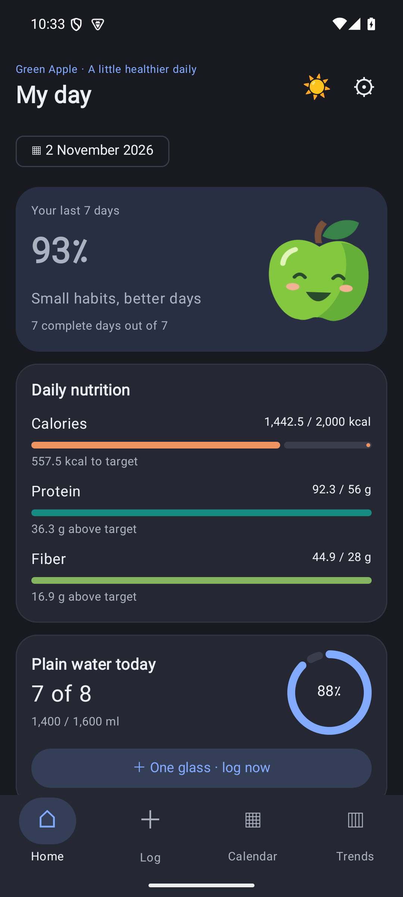
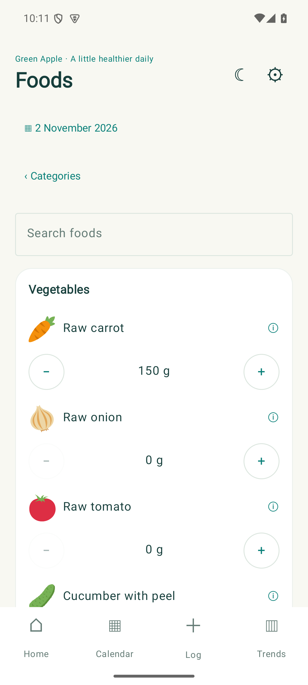
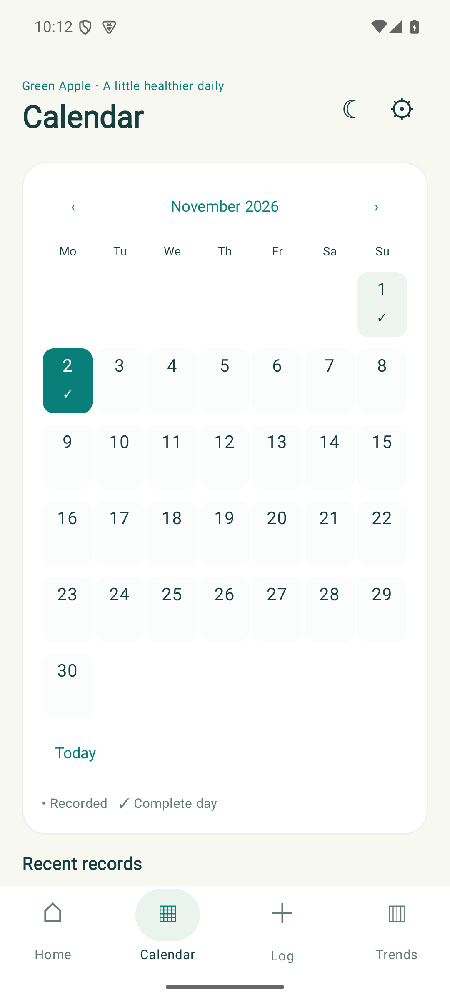
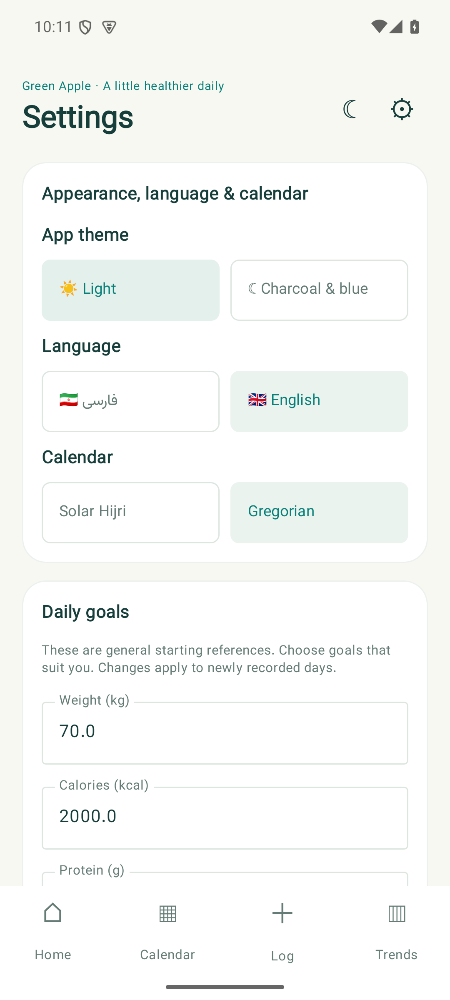
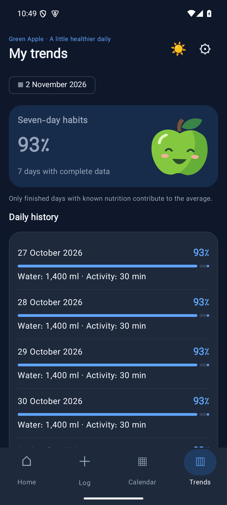

<h1> Green Apple</h1>

An offline Android companion for tracking food, water, movement and everyday habits. Built with **Kotlin** and a fully native **Jetpack Compose** interface.

**Android 11+ · English and Persian · Light and dark themes · No account required**

[Download the latest release](https://github.com/zianazari/Green-Apple/releases/latest) · [Browse the source](app/src/main/java/com/sabz/companion)

## Technology

  
  
  
  
  

Native Android APIs handle local JSON storage, notifications, Persian/Gregorian calendars and PDF export.

## Screenshots

The English interface, captured from version **2.1.0** on an Android emulator. All records shown are sample data. Version 2.1.1 restores the midnight-blue dark palette; these screenshots show the previous dark palette.

<table>
  <tr>
    <th>Daily overview · dark theme</th>
    <th>Food logging · light theme</th>
  </tr>
  <tr>
    <td></td>
    <td></td>
  </tr>
  <tr>
    <th>Calendar and history</th>
    <th>Appearance and language</th>
  </tr>
  <tr>
    <td></td>
    <td></td>
  </tr>
</table>

### Updated Trends

Version **2.1.2** uses a compact daily-history list and the same text sizing as Home. This screenshot uses sample records and the midnight-blue theme.

## What you can do

- **Log food and drinks immediately.** Browse illustrated categories, search the catalogue or use your personal frequent-food list. Adjust portions with inline **+ / −** controls or enter an exact amount.
- **Use practical portions.** The first food increment adds its base portion; subsequent steps adjust it by 20%. Drinks use 200 ml glasses.
- **Set up a starting profile.** Enter height, weight and age together. An optional sex-specific equation and your usual activity level provide an adult maintenance-calorie estimate and a weight-based protein reference. Review, edit and save the targets before logging.
- **Track daily nutrition.** View calories, protein, fiber, plain water and total drinks against configurable goals.
- **Record movement and sitting.** Log walking, moderate exercise, stretching and other activity in minutes. Track sitting duration, standing breaks and Kegel sessions separately.
- **Let intervals organize themselves.** Records are grouped into three-hour intervals. Empty periods merge into the next recorded interval within the same day. A newly recorded interval includes an adjustable one-hour sitting default.
- **Review and edit past days.** Choose a date using a Gregorian or Persian calendar, inspect individual entries and update them.
- **Finish a day with one tap.** Empty or partially recorded days can be finished too. Reopen a day or edit its records later.
- **Follow your habits over time.** An animated green apple accompanies your seven-day habit score. Only finished days with known nutrition contribute to the average.
- **Keep and export your records.** Save a native PDF report for a range of up to 31 days, or export and restore a JSON backup.

English and Persian interfaces include right-to-left support and the bundled Vazirmatn font. Light and midnight-blue dark themes are available. Language, theme and calendar options are visible together in Settings. English is the default for new installations; existing language preferences are preserved. The Log tab sits next to Home, and frequent foods appear only in Quick log. Calendars use orange dots for recorded days, an outline for today, Saturday-first Persian weeks and Sunday-first Gregorian weeks.

## Install or update

1. Open [Releases](https://github.com/zianazari/Green-Apple/releases/latest).
2. Download the APK file under **Assets**.
3. Open it on a device running **Android 11 or newer**. If Android requests permission, allow installation from the app you used to open the file.
4. Install over the existing Green Apple app to retain its records.

Do not uninstall the previous version when updating. Export a JSON backup before uninstalling or changing phones.

The latest published version is [2.1.4](https://github.com/zianazari/Green-Apple/releases/tag/v2.1.4), which keeps food portion **+** buttons on the right and **−** buttons on the left in both English and Persian. Android displays **Green Apple** during installation and beneath the launcher icon, regardless of the selected interface language. Day completion remains immediate even when some or all fields are empty.

## Initial profile and goal estimates

Height, weight and age are stored together in Settings. Calorie estimates use the [2023 DRI adult energy equations published by Health Canada](https://www.canada.ca/en/health-canada/services/food-nutrition/healthy-eating/dietary-reference-intakes/tables/equations-estimate-energy-requirement.html), with a selected sex-specific equation and usual activity category. If sex is not specified, the app shows a range rather than assuming one equation.

Estimates are for weight maintenance in adults aged 19 and above, excluding pregnancy and breastfeeding. The protein starting reference is 0.8 g/kg body weight. Estimates do not automatically replace targets: review the proposed values, apply them and save. Manual targets remain available. Updated goals apply to newly recorded days, preserving the goals attached to historical records.

## Reminders

Check-in prompts are scheduled for **09:00, 12:00, 15:00 and 18:00**. A daily review is scheduled for **22:00**. Movement and water reminders occur every two hours within your chosen waking hours; coinciding reminders are combined.

Enable reminders in Settings and grant Android's notification permission. Exact-alarm access and device battery settings can affect delivery time. Force-stopping the app prevents reminders until it is opened again.

## Privacy and existing records

Your records stay on the device. The app has no account, backend, analytics or <code>INTERNET</code> permission. External source links open in your browser.

The native version preserves compatibility with earlier Green Apple / Sabz installations:

- The application ID remains <code>com.sabz.companion</code>.
- Published APKs use the original signing key.
- Existing version-1 JSON records and backups remain readable.
- Record IDs, embedded food data, custom foods, dates and daily goals are preserved.
- The first successful native save retains the original state as <code>preNativeState</code>.
- Invalid existing data disables writes and can be exported for recovery. An invalid import does not replace current records.

Nutrition values are approximate and goals are configurable. Green Apple supports general habit tracking and does not provide a medical diagnosis.

## Build from source

### Requirements

- **JDK 17**
- **Android SDK platform 35**
- **Android Build Tools 35.0.0**

Open the project in Android Studio, or set <code>JAVA_HOME</code> and <code>ANDROID_HOME</code> and use the included wrapper:

    ./gradlew :app:assembleDebug

The debug APK is written to <code>app/build/outputs/apk/debug/app-debug.apk</code>.

To compile a release:

    ./gradlew :app:assembleRelease

The unsigned APK is written to <code>app/build/outputs/apk/release/app-release-unsigned.apk</code>. Sign it with a protected signing key before distributing it. A build signed with a different key cannot replace the published installation.

The project pins Gradle **8.9**, AGP **8.7.3**, Kotlin and the Compose compiler **2.0.21**, Compose BOM **2024.12.01**, and Build Tools **35.0.0**. The wrapper includes the official Gradle distribution checksum. The release signing key is excluded from the repository.

## Verification

Run the unit tests and Android compatibility checks:

    ./gradlew :app:testDebugUnitTest :app:lintDebug

With an emulator or test device connected:

    ./gradlew :app:connectedDebugAndroidTest

Tests cover legacy backup validation, numerical parity with 25 legacy data fixtures, interval merging, explicit zeros, separate Kegel counts, local-time and daylight-saving reminder scheduling, and completion of empty or partially recorded days.

Native UI checks cover food registration, persistent settings, custom-food drafts, sitting controls, Persian calendar names and native PDF generation. An in-place upgrade was also checked in an Android 15 emulator by comparing stored legacy data before and after installation. Physical-device testing has not yet been performed.

## Project structure

| Component | Responsibility |
| --- | --- |
| [Profile.kt](app/src/main/java/com/sabz/companion/Profile.kt) | Adult energy estimates from height, weight, age, sex and activity level |
| [ProfilePanel.kt](app/src/main/java/com/sabz/companion/ProfilePanel.kt) | Grouped initial measurements, estimate preview and target selection |
| [Domain.kt](app/src/main/java/com/sabz/companion/Domain.kt) | Nutrition totals, validation, intervals and habit scores |
| [Store.kt](app/src/main/java/com/sabz/companion/Store.kt) | Persisted records, immediate updates and legacy compatibility |
| [AppUi.kt](app/src/main/java/com/sabz/companion/AppUi.kt) | App theme, navigation and daily overview |
| [LogScreens.kt](app/src/main/java/com/sabz/companion/LogScreens.kt) | Food, drink, sitting and activity entry |
| [HistoryScreens.kt](app/src/main/java/com/sabz/companion/HistoryScreens.kt) | Calendars, history, day details, trends and report selection |
| [SettingsScreen.kt](app/src/main/java/com/sabz/companion/SettingsScreen.kt) | Preferences, goals, reminders and custom foods |
| [CalendarTools.kt](app/src/main/java/com/sabz/companion/CalendarTools.kt) | ICU Persian/Gregorian calendars and localized formatting |
| [NativeReport.kt](app/src/main/java/com/sabz/companion/NativeReport.kt) | PDF export using Android text shaping, Canvas and PdfDocument |
| [ReminderReceiver.kt](app/src/main/java/com/sabz/companion/ReminderReceiver.kt) | Notification delivery and alarm rescheduling |
| [ReminderSchedule.kt](app/src/main/java/com/sabz/companion/ReminderSchedule.kt) | Local-time alarm calculations and nightly feedback |

All production application code is Kotlin. Screens use Jetpack Compose, reports use Android's native PDF APIs, and food illustrations use VectorDrawables. There is no WebView or JavaScript runtime.

## Data, artwork and attribution

- **Nutrition catalogue:** [USDA SR Legacy (2018)](https://fdc.nal.usda.gov/download-datasets/). Food source identifiers are included in the bundled catalogue. Grapes use FDC 174683; milk chocolate uses FDC 167587. Cream cake is an explicitly labelled recipe estimate: 70% commercially prepared sponge cake (FDC 172706) and 30% whipped cream topping (FDC 170860). Values are stored per 100 g and scale with the logged portion. Its default portion is 100 g, as for grapes; milk chocolate starts at 30 g.
- **Typography:** [Vazirmatn](https://github.com/rastikerdar/vazirmatn), distributed under the [SIL Open Font License](app/src/main/assets/Vazirmatn-OFL.txt).
- **Food illustrations:** Twemoji, copyright Twitter and jdecked contributors, licensed under [CC BY 4.0](app/src/main/assets/art/LICENSE-GRAPHICS). Original SVG sources are retained in <code>app/src/main/assets/art/</code>; displayed artwork is converted to native Android vectors.
- **Green apple companion and launcher icon:** maintained as native vector artwork in this project.
